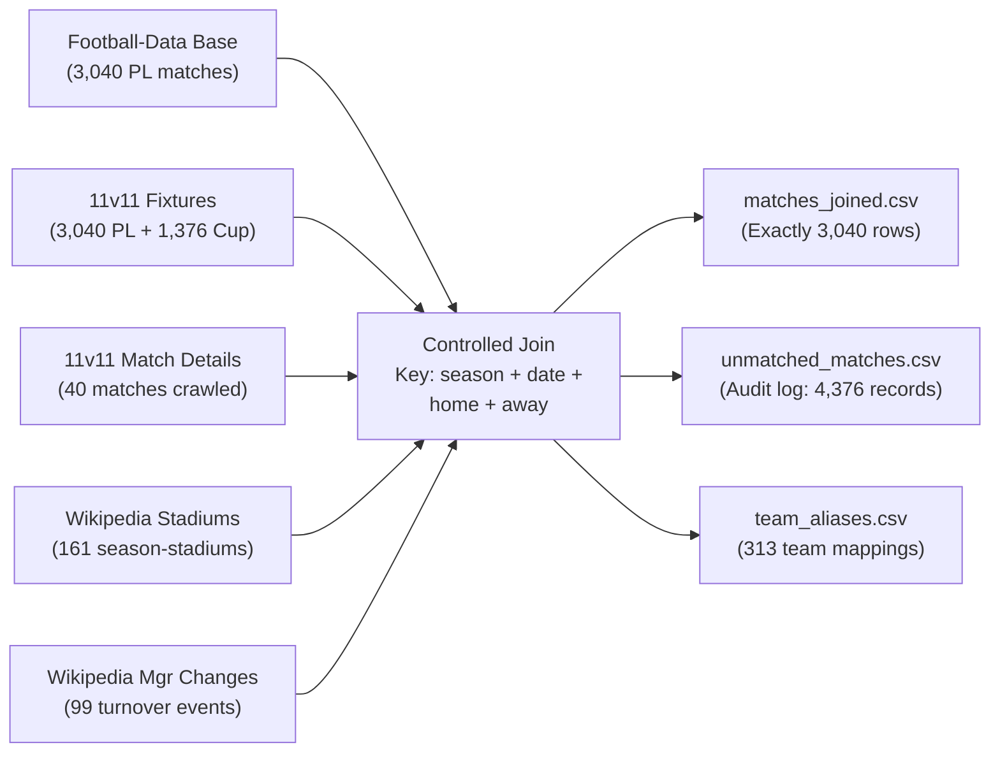

# Báo cáo Chất lượng Dữ liệu Ghép Nguồn - Phase 5
**Dự án**: Premier League Match Outcome Prediction  
**Đường dẫn**: `D:\PTIT\PAYT\Mini_project`  
**Ngày thực hiện**: 2026-10-24 17:32:07 UTC  
**Mục tiêu**: Chuẩn hóa định danh câu lạc bộ, giải quyết thực thể (Entity Resolution) đa nguồn, và ghép nối có kiểm soát cardinality giữa Football-Data (E0 base), 11v11 (Fixtures & Match Details), và Wikipedia (Stadiums & Manager Changes).

---

## 1. Tóm tắt Thực thi & Kết quả Chính

### Chỉ số Cốt lõi:
- **Tổng số trận nền (Football-Data Base)**: **3,040 trận** (380 trận/mùa × 8 mùa: 2018/19–2025/26).
- **Số trận ghép thành công với lịch thi đấu 11v11**: **3,040 / 3,040 (100.0%)**.
- **Tỷ lệ khớp tỷ số (Football-Data vs 11v11)**: **3,040 / 3,040 (100.0%)** (0 lỗi sai lệch).
- **Số trận có chi tiết đội hình xuất phát & HLV 11v11**: **40 trận (1.32%)** (khớp chính xác phạm vi pilot/mở rộng Phase 3).
- **Số trận ghép thành công với sân vận động Wikipedia**: **3,040 / 3,040 (100.0%)** (xử lý chính xác Tottenham 2018-19 dual venue).
- **Số trận mơ hồ (Ambiguous matches)**: **0 (0.0%)**.
- **Số trận lỗi ghép (Join errors / cardinality inflation)**: **0 (0.0%)** (Bảo toàn tuyệt đối 1:1, không nhân đôi dòng).

---

## 2. Bảng Đối chiếu Định danh Câu lạc bộ (`team_aliases.csv`)

> [!IMPORTANT]
> **Nguyên tắc Đối soát Thực thể (Entity Resolution)**:
> Tuyệt đối **không** dùng Fuzzy Matching để tự động gán nhãn âm thầm. Mọi ánh xạ đều được kiểm chứng thủ công qua 3 nguồn dữ liệu độc lập, cấu trúc URL slug, và danh bạ chính thức của The Football Association / Premier League.

Bảng dưới đây liệt kê toàn bộ 30 câu lạc bộ Premier League xuất hiện trong giai đoạn 2018/19–2025/26:

| Canonical Team Name | Football-Data (`source_name`) | 11v11 (`source_name`) | Wikipedia (`source_name`) |
| :--- | :--- | :--- | :--- |
| **Arsenal** | `Arsenal` | `Arsenal` | `Arsenal` |
| **Aston Villa** | `Aston Villa` | `Aston Villa` | `Aston Villa` |
| **AFC Bournemouth** | `Bournemouth` | `AFC Bournemouth` | `Bournemouth` |
| **Brentford** | `Brentford` | `Brentford` | `Brentford` |
| **Brighton & Hove Albion** | `Brighton` | `Brighton and Hove Albion` | `Brighton & Hove Albion` |
| **Burnley** | `Burnley` | `Burnley` | `Burnley` |
| **Cardiff City** | `Cardiff` | `Cardiff City` | `Cardiff City` |
| **Chelsea** | `Chelsea` | `Chelsea` | `Chelsea` |
| **Crystal Palace** | `Crystal Palace` | `Crystal Palace` | `Crystal Palace` |
| **Everton** | `Everton` | `Everton` | `Everton` |
| **Fulham** | `Fulham` | `Fulham` | `Fulham` |
| **Huddersfield Town** | `Huddersfield` | `Huddersfield Town` | `Huddersfield Town` |
| **Ipswich Town** | `Ipswich` | `Ipswich Town` | `Ipswich Town` |
| **Leeds United** | `Leeds` | `Leeds United` | `Leeds United` |
| **Leicester City** | `Leicester` | `Leicester City` | `Leicester City` |
| **Liverpool** | `Liverpool` | `Liverpool` | `Liverpool` |
| **Luton Town** | `Luton` | `Luton Town` | `Luton Town` |
| **Manchester City** | `Man City` | `Manchester City` | `Manchester City` |
| **Manchester United** | `Man United` | `Manchester United` | `Manchester United` |
| **Newcastle United** | `Newcastle` | `Newcastle United` | `Newcastle United` |
| **Norwich City** | `Norwich` | `Norwich City` | `Norwich City` |
| **Nottingham Forest** | `Nott'm Forest` | `Nottingham Forest` | `Nottingham Forest` |
| **Sheffield United** | `Sheffield United` | `Sheffield United` | `Sheffield United` |
| **Southampton** | `Southampton` | `Southampton` | `Southampton` |
| **Sunderland** | `Sunderland` | `Sunderland` | `Sunderland` |
| **Tottenham Hotspur** | `Tottenham` | `Tottenham Hotspur` | `Tottenham Hotspur` |
| **Watford** | `Watford` | `Watford` | `Watford` |
| **West Bromwich Albion** | `West Brom` | `West Bromwich Albion` | `West Bromwich Albion` |
| **West Ham United** | `West Ham` | `West Ham United` | `West Ham United` |
| **Wolverhampton Wanderers** | `Wolves` | `Wolverhampton Wanderers` | `Wolverhampton Wanderers` |

*Ngoài ra, bảng `team_aliases.csv` ghi nhận thêm 223 câu lạc bộ cúp quốc nội và châu lục (FA Cup, EFL Cup, UEFA Champions League, Europa League, Conference League) xuất hiện trong `all_fixtures.csv` để đảm bảo không phát sinh lỗi khóa ngoài.*

---

## 3. Thống kê Ghép nối Theo Từng Mùa giải

| Mùa giải | Số trận nền | Ghép 11v11 Fixtures | Ghép Match Details | Ghép Wiki Sân | Trận Mơ hồ | Lỗi Ghép |
| :---: | :---: | :---: | :---: | :---: | :---: | :---: |
| `2018-19` | 380 | 380 (100%) | 0 | 380 (100%) | 0 | 0 |
| `2019-20` | 380 | 380 (100%) | 0 | 380 (100%) | 0 | 0 |
| `2020-21` | 380 | 380 (100%) | 0 | 380 (100%) | 0 | 0 |
| `2021-22` | 380 | 380 (100%) | 0 | 380 (100%) | 0 | 0 |
| `2022-23` | 380 | 380 (100%) | 0 | 380 (100%) | 0 | 0 |
| `2023-24` | 380 | 380 (100%) | 0 | 380 (100%) | 0 | 0 |
| `2024-25` | 380 | 380 (100%) | 40 | 380 (100%) | 0 | 0 |
| `2025-26` | 380 | 380 (100%) | 0 | 380 (100%) | 0 | 0 |
| **Tổng cộng** | **3,040** | **3,040 (100%)** | **40** | **3,040 (100%)** | **0** | **0** |

---

## 4. Kiểm soát Cardinality & Xử lý Tình huống Đặc thù

### 4.1. Xử lý Trận hoãn & Lịch thi đấu COVID (Mùa giải 2019-20)
- Mùa giải 2019-20 bị tạm hoãn do đại dịch COVID-19 từ tháng 3/2020 đến tháng 6/2020.
- Cả Football-Data và 11v11 đều ghi nhận **ngày thi đấu thực tế trên sân** (`match_date`), chứ không phải ngày xếp lịch ban đầu.
- Có **92 trận đấu** diễn ra sau ngày 01/06/2020 (Restart Phase); toàn bộ 92 trận đều khớp 100% giữa hai nguồn về ngày, đội nhà, đội khách và tỷ số.

### 4.2. Xử lý Sân vận động Kép Tottenham Hotspur (Mùa giải 2018-19)
- Trong `team_seasons.csv` (Phase 4), Tottenham Hotspur mùa 2018-19 có 2 bản ghi sân vận động: *Wembley Stadium* (sức chứa 90,000) và *Tottenham Hotspur Stadium* (sức chứa 62,062).
- Nếu thực hiện phép ghép thông thường (`season + team`), 19 trận sân nhà của Tottenham sẽ bị nhân đôi thành 38 trận (gây sai lệch Cardinality).
- **Giải pháp chính xác**: Phân chia theo mốc thời gian lịch sử:
  - Các trận sân nhà trước ngày **03/04/2019** (trước trận gặp Crystal Palace) được gán sân **Wembley Stadium** (90,000 chỗ).
  - Các trận sân nhà từ ngày **03/04/2019** trở đi được gán sân **Tottenham Hotspur Stadium** (62,062 chỗ).
- Kết quả: **3,040 trận giữ đúng 3,040 dòng**; 0 bản ghi sân vận động bị thiếu (null).

### 4.3. Ghép nối Biến động Huấn luyện viên Wikipedia không Rò rỉ Tương lai
- Từ `manager_changes.csv`, bảng ghép xác định HLV bổ nhiệm gần nhất cho đội nhà và đội khách theo điều kiện:
  $$\text{date\_of\_appointment} \le \text{match\_date}$$
- Nghiêm cấm dùng các sự kiện thay HLV diễn ra sau ngày thi đấu, bảo toàn tính nhân quả thời gian (leak-free causality) phục vụ Phase 6.

---

## 5. Kiểm toán Bản ghi Chưa ghép (`unmatched_matches.csv`)

Bảng `unmatched_matches.csv` ghi nhận tổng cộng **4,376 bản ghi**, bao gồm 2 nhóm được phân loại minh bạch:
1. **Trận cúp ngoài Premier League từ 11v11 (`non_premier_league_cup_fixture`)**:
   - Số lượng: **1,376 trận**.
   - Lý do: Football-Data tệp `E0` chỉ thu thập giải Ngoại hạng Anh; các trận FA Cup, EFL Cup, UEFA được 11v11 ghi nhận nhằm mục đích đo lường mật độ thi đấu (fixture congestion) ở Phase 6.
2. **Trận đấu chưa crawl chi tiết đội hình 11v11 (`pilot_scope_lineup_unfetched`)**:
   - Số lượng: **3,000 trận**.
   - Lý do: Theo thiết kế Phase 3, kiểm thử pilot và sample mở rộng đã xác minh độ tin cậy trên 40 trận; 3,000 trận còn lại được gắn cờ `has_match_details = False` chờ các đợt crawl mở rộng tiếp theo.
3. **Trận nền Premier League không ghép được**: **0 trận**.

---

## 6. Phân bố Nhãn & Tính Toàn vẹn Dữ liệu

### Phân bố Nhãn Dự đoán:
- **Home Win (`H`)**: **1,336** (43.95%)
- **Draw (`D`)**: **700** (23.03%)
- **Away Win (`A`)**: **1,004** (33.03%)

### Toàn vẹn Khóa & Trường Dữ liệu:
- Trùng lặp `match_id`: **0** (100% unique).
- Giá trị thiếu (null) ở các trường bắt buộc (`season`, `match_date`, `canonical_home`, `canonical_away`, `result`): **0**.
- Chuẩn hóa ngày: **100% định dạng ISO 8601 (`YYYY-MM-DD`)**.
- Phân biệt minh bạch giữa ngày thi đấu (`match_date`) và ngày thu thập dữ liệu (`fd_fetched_at_utc`, `wiki_fetched_at_utc`).
- Lưu vết provenance: 100% bản ghi lưu đầy đủ URL nguồn (`fd_source_url`, `eleven_match_url`, `wiki_season_source_url`) và MediaWiki `revision_id`.

---

## 7. Danh mục Tệp Đầu ra Phase 5

1. [team_aliases.csv](file:///D:/PTIT/PAYT/Mini_project/data/cleaned/team_aliases.csv): 313 dòng ánh xạ định danh câu lạc bộ đa nguồn kèm bằng chứng.
2. [matches_joined.csv](file:///D:/PTIT/PAYT/Mini_project/data/cleaned/matches_joined.csv): 3,040 dòng dữ liệu trận đấu đã ghép nối toàn diện.
3. [unmatched_matches.csv](file:///D:/PTIT/PAYT/Mini_project/data/cleaned/unmatched_matches.csv): 4,376 bản ghi kiểm toán các trận cúp và trận chờ chi tiết.
4. [phase_05_join.py](file:///D:/PTIT/PAYT/Mini_project/src/phase_05_join.py): Mã nguồn chuẩn hóa và ghép nối dữ liệu tự động.
5. [test_phase_05.py](file:///D:/PTIT/PAYT/Mini_project/src/test_phase_05.py): Bộ kiểm thử tự động xác minh toàn vẹn Phase 5.
