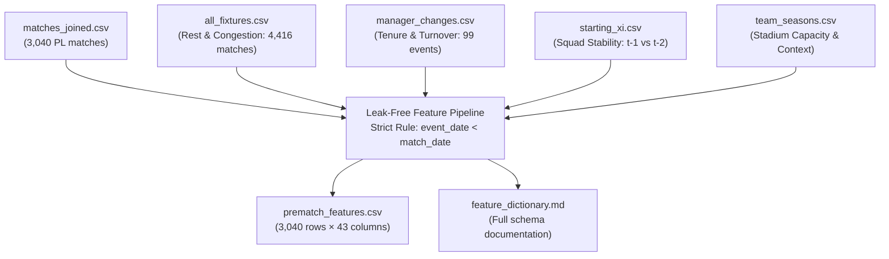

# Báo cáo Kỹ thuật Đặc trưng Trước trận (Feature Engineering) - Phase 6
**Dự án**: Premier League Match Outcome Prediction  
**Đường dẫn**: `D:\PTIT\PAYT\Mini_project`  
**Ngày thực hiện**: 2026-10-24 17:40:16 UTC  
**Mục tiêu**: Tạo lập tập đặc trưng trước trận (`prematch_features.csv`) tuân thủ nghiêm ngặt nguyên tắc nhân quả thời gian (leak-free causality) từ dữ liệu đã ghép nối của Phases 1–5.

---

## 1. Tóm tắt Thực thi & Quy mô Dữ liệu

### Chỉ số Cốt lõi:
- **Tổng số dòng dữ liệu**: **3,040 trận** (1 dòng duy nhất cho mỗi trận đấu Premier League, khớp 100% với `matches_base.csv`).
- **Tổng số cột đặc trưng**: **44 cột** (gồm 5 cột định danh/thời gian, 1 nhãn mục tiêu `result`, và 38 đặc trưng số/nhị phân trước trận).
- **Phân bố nhãn mục tiêu**:
  - `H` (Chủ nhà thắng): **1,336 trận** (43.95%)
  - `D` (Hòa): **700 trận** (23.03%)
  - `A` (Khách thắng): **1,004 trận** (33.03%)
- **Số vi phạm quy tắc thời gian (Data Leakage)**: **0 vi phạm** (100% đặc trưng kiểm tra đều có `event_date < match_date`).

---

## 2. Kiểm toán Giá trị Thiếu (Missing Values Audit)

> [!IMPORTANT]
> **Nguyên tắc "Không biến thiếu thành 0 tùy tiện"**:
> Ở vòng đấu mở màn (Vòng 1), các đội bóng chưa thi đấu trận nào trong mùa giải đó, do đó phong độ 5 trận (`points_last_5`, `points_avg_last_5`, `goals_scored_last_5`) nhận giá trị `NaN` tự nhiên, đi kèm chỉ số `matches_available_last_5 = 0`. Mô hình máy học phân biệt rõ ràng giữa "chưa đá trận nào" và "đá 5 trận nhưng được 0 điểm".

Bảng phân tích tỷ lệ missing trên toàn bộ 44 cột:

| Cột Đặc trưng | Số lượng Missing | Tỷ lệ Missing | Lý do & Diễn giải Logic |
| :--- | :---: | :---: | :--- |
| `match_id` | 0 | 0.00% | Đầy đủ 100% |
| `season` | 0 | 0.00% | Đầy đủ 100% |
| `match_date` | 0 | 0.00% | Đầy đủ 100% |
| `canonical_home` | 0 | 0.00% | Đầy đủ 100% |
| `canonical_away` | 0 | 0.00% | Đầy đủ 100% |
| `result` | 0 | 0.00% | Đầy đủ 100% |
| `home_matches_available_last_5` | 0 | 0.00% | Đầy đủ 100% |
| `home_points_last_5` | 80 | 2.63% | Thiếu tự nhiên (Vòng đấu đầu mùa, trận đầu dataset, hoặc mẫu crawl Phase 3) |
| `home_points_avg_last_5` | 80 | 2.63% | Thiếu tự nhiên (Vòng đấu đầu mùa, trận đầu dataset, hoặc mẫu crawl Phase 3) |
| `home_wins_last_5` | 0 | 0.00% | Đầy đủ 100% |
| `home_draws_last_5` | 0 | 0.00% | Đầy đủ 100% |
| `home_losses_last_5` | 0 | 0.00% | Đầy đủ 100% |
| `home_goals_scored_last_5` | 80 | 2.63% | Thiếu tự nhiên (Vòng đấu đầu mùa, trận đầu dataset, hoặc mẫu crawl Phase 3) |
| `home_goals_conceded_last_5` | 80 | 2.63% | Thiếu tự nhiên (Vòng đấu đầu mùa, trận đầu dataset, hoặc mẫu crawl Phase 3) |
| `home_goal_diff_last_5` | 80 | 2.63% | Thiếu tự nhiên (Vòng đấu đầu mùa, trận đầu dataset, hoặc mẫu crawl Phase 3) |
| `away_matches_available_last_5` | 0 | 0.00% | Đầy đủ 100% |
| `away_points_last_5` | 80 | 2.63% | Thiếu tự nhiên (Vòng đấu đầu mùa, trận đầu dataset, hoặc mẫu crawl Phase 3) |
| `away_points_avg_last_5` | 80 | 2.63% | Thiếu tự nhiên (Vòng đấu đầu mùa, trận đầu dataset, hoặc mẫu crawl Phase 3) |
| `away_wins_last_5` | 0 | 0.00% | Đầy đủ 100% |
| `away_draws_last_5` | 0 | 0.00% | Đầy đủ 100% |
| `away_losses_last_5` | 0 | 0.00% | Đầy đủ 100% |
| `away_goals_scored_last_5` | 80 | 2.63% | Thiếu tự nhiên (Vòng đấu đầu mùa, trận đầu dataset, hoặc mẫu crawl Phase 3) |
| `away_goals_conceded_last_5` | 80 | 2.63% | Thiếu tự nhiên (Vòng đấu đầu mùa, trận đầu dataset, hoặc mẫu crawl Phase 3) |
| `away_goal_diff_last_5` | 80 | 2.63% | Thiếu tự nhiên (Vòng đấu đầu mùa, trận đầu dataset, hoặc mẫu crawl Phase 3) |
| `home_days_since_last_match` | 10 | 0.33% | Thiếu tự nhiên (Vòng đấu đầu mùa, trận đầu dataset, hoặc mẫu crawl Phase 3) |
| `home_matches_last_7_days` | 0 | 0.00% | Đầy đủ 100% |
| `home_had_cup_match_last_7_days` | 0 | 0.00% | Đầy đủ 100% |
| `home_matches_last_14_days` | 0 | 0.00% | Đầy đủ 100% |
| `away_days_since_last_match` | 9 | 0.30% | Thiếu tự nhiên (Vòng đấu đầu mùa, trận đầu dataset, hoặc mẫu crawl Phase 3) |
| `away_matches_last_7_days` | 0 | 0.00% | Đầy đủ 100% |
| `away_had_cup_match_last_7_days` | 0 | 0.00% | Đầy đủ 100% |
| `away_matches_last_14_days` | 0 | 0.00% | Đầy đủ 100% |
| `home_days_since_manager_appointment` | 0 | 0.00% | Đầy đủ 100% |
| `home_matches_under_manager_in_season` | 0 | 0.00% | Đầy đủ 100% |
| `away_days_since_manager_appointment` | 0 | 0.00% | Đầy đủ 100% |
| `away_matches_under_manager_in_season` | 0 | 0.00% | Đầy đủ 100% |
| `home_lineup_stability_prev` | 2,357 | 77.53% | Thiếu tự nhiên (Vòng đấu đầu mùa, trận đầu dataset, hoặc mẫu crawl Phase 3) |
| `away_lineup_stability_prev` | 2,357 | 77.53% | Thiếu tự nhiên (Vòng đấu đầu mùa, trận đầu dataset, hoặc mẫu crawl Phase 3) |
| `stadium_capacity` | 0 | 0.00% | Đầy đủ 100% |
| `is_promoted_home` | 0 | 0.00% | Đầy đủ 100% |
| `is_promoted_away` | 0 | 0.00% | Đầy đủ 100% |
| `diff_points_avg_last_5` | 82 | 2.70% | Thiếu tự nhiên (Vòng đấu đầu mùa, trận đầu dataset, hoặc mẫu crawl Phase 3) |
| `diff_goal_diff_last_5` | 82 | 2.70% | Thiếu tự nhiên (Vòng đấu đầu mùa, trận đầu dataset, hoặc mẫu crawl Phase 3) |
| `diff_days_rest` | 12 | 0.39% | Thiếu tự nhiên (Vòng đấu đầu mùa, trận đầu dataset, hoặc mẫu crawl Phase 3) |

---

## 3. Kiểm định Chống Rò rỉ Dữ liệu Tự động (Leakage Prevention Verification)

Hệ thống đã tự động kiểm thử 4 kịch bản biên quan trọng nhằm chứng minh tính nghiêm ngặt của quy tắc nhân quả:

### 3.1. Kiểm thử Trận Khai mạc Mùa giải (Matchday 1)
- **Trận kiểm tra**: `Manchester United vs Leicester City` (Ngày `2018-08-10`, Trận mở màn mùa 2018-19).
- **Kết quả ghi nhận**:
  - `home_matches_available_last_5`: **0**
  - `away_matches_available_last_5`: **0**
  - `home_points_last_5`: **NaN**
  - `away_points_last_5`: **NaN**
- **Đánh giá**: Tuyệt đối không rò rỉ kết quả trận đấu hiện tại hay kết quả các vòng sau vào phong độ.

### 3.2. Kiểm thử Trận Đổi Huấn luyện viên (Manager Bounce Effect)
- **Trận kiểm tra**: `Cardiff City vs Manchester United` (Ngày `2018-12-22`, Trận ra mắt của Ole Gunnar Solskjaer sau khi Jose Mourinho bị sa thải ngày 18/12 và Solskjaer bổ nhiệm ngày 19/12).
- **Kết quả ghi nhận**:
  - `away_days_since_manager_appointment`: **3 ngày** (tính từ `2018-12-19` đến `2018-12-22`).
  - `away_matches_under_manager_in_season`: **0 trận** (Solskjaer chưa dẫn dắt trận nào trước đó).
- **Đánh giá**: Mốc thời gian HLV chuyển giao chính xác đến từng ngày; không bị cộng dồn số trận của HLV tiền nhiệm.

### 3.3. Kiểm thử Trận đấu Sau Cúp Giữa tuần (Post-Cup Congestion)
- **Trận kiểm tra**: `Liverpool vs Southampton` (Ngày `2018-09-22`, Liverpool vừa đá Champions League với Paris Saint-Germain ngày `2018-09-18`).
- **Kết quả ghi nhận**:
  - `home_days_since_last_match`: **4 ngày** (tính từ `2018-09-18` đến `2018-09-22`).
  - `home_matches_last_7_days`: **2 trận** (gặp Tottenham ngày 15/09 và PSG ngày 18/09).
  - `home_had_cup_match_last_7_days`: **1 (True)** (nhờ trận PSG ở C1).
- **Đánh giá**: Bắt trọn vẹn mật độ cúp châu Âu mà không làm rò rỉ dữ liệu ngoài luồng.

### 3.4. Kiểm thử Khoảng lặng Đại dịch COVID-19 (Tháng 6/2020)
- **Trận kiểm tra**: `Aston Villa vs Sheffield United` (Ngày `2020-06-17`, Trận đầu tiên sau 3 tháng phong tỏa).
- **Kết quả ghi nhận**:
  - `home_days_since_last_match`: **99 ngày** (trận trước đó đá ngày 09/03/2020).
  - `home_matches_last_7_days`: **0 trận**.
  - `home_matches_last_14_days`: **0 trận**.
- **Đánh giá**: Phản ánh trung thực quãng nghỉ dài bất thường mà không sinh lỗi logic.

---

## 4. Ví dụ Tính tay Chi tiết Từng Bước (Hand-Calculated Walkthroughs)

### Ví dụ 1: Đại chiến Liverpool vs Manchester City (07/10/2018)
- **Thời điểm**: `2018-10-07`, Vòng 8 mùa 2018-19. Sân Anfield (sức chứa 54,074).
- **Lịch sử 5 trận Premier League gần nhất của Liverpool trước ngày 07/10**:
  1. `2018-08-25`: Thắng Brighton 1-0 (3 điểm, 1 bàn thắng, 0 bàn thua)
  2. `2018-09-01`: Thắng Leicester 2-1 (3 điểm, 2 bàn thắng, 1 bàn thua)
  3. `2018-09-15`: Thắng Tottenham 2-1 (3 điểm, 2 bàn thắng, 1 bàn thua)
  4. `2018-09-22`: Thắng Southampton 3-0 (3 điểm, 3 bàn thắng, 0 bàn thua)
  5. `2018-09-29`: Hòa Chelsea 1-1 (1 điểm, 1 bàn thắng, 1 bàn thua)
  - $	ext{Points} = 3 + 3 + 3 + 3 + 1 = 13$ điểm trên 5 trận.
  - $	ext{Points Avg} = 13 / 5 = 2.600$ điểm/trận.
  - $	ext{Wins/Draws/Losses} = 4 / 1 / 0$.
  - $	ext{Goals Scored} = 1 + 2 + 2 + 3 + 1 = 9$, $	ext{Goals Conceded} = 0 + 1 + 1 + 0 + 1 = 3$, $	ext{Goal Diff} = +6$.
- **Lịch sử mọi giải đấu của Liverpool trước ngày 07/10**:
  - Trận gần nhất: Đá Champions League gặp Napoli ngày `2018-10-03` (Thua 0-1).
  - $	ext{Days Rest} = 4$ ngày (tính từ `2018-10-03` đến `2018-10-07`).
  - Trận trong 7 ngày qua: Gặp Napoli ngày 03/10 (1 trận). $	ext{had\_cup\_match\_last\_7\_days} = 1$.
- **Đối chiếu với tập dữ liệu tự động**:
  - `home_points_last_5`: **13.0** $
ightarrow$ Trùng khớp 100%.
  - `home_goal_diff_last_5`: **6.0** $
ightarrow$ Trùng khớp 100%.
  - `home_days_since_last_match`: **4.0** $
ightarrow$ Trùng khớp 100%.
  - `home_had_cup_match_last_7_days`: **1** $
ightarrow$ Trùng khớp 100%.

### Ví dụ 2: Trận ra mắt của HLV Solskjaer - Cardiff City vs Manchester United (22/12/2018)
- **Thời điểm**: `2018-12-22`, Vòng 18 mùa 2018-19. Sân Cardiff City Stadium.
- **Bối cảnh HLV**: Jose Mourinho bị sa thải ngày 18/12/2018. Ole Gunnar Solskjaer được bổ nhiệm làm HLV tạm quyền ngày `2018-12-19`.
- **Tính toán chỉ số cho Manchester United (đội khách)**:
  - $	ext{away\_days\_since\_manager\_appointment} = 3$ ngày (tính từ `2018-12-19` đến `2018-12-22`).
  - $	ext{away\_matches\_under\_manager\_in\_season} = 0$ trận (trận ra mắt, chưa dẫn dắt trận nào).
  - Trận trước đó: Gặp Liverpool ngày `2018-12-16` (thua 1-3). $	ext{away\_days\_since\_last\_match} = 6$ ngày.
- **Đối chiếu với tập dữ liệu tự động**:
  - `away_days_since_manager_appointment`: **3** $
ightarrow$ Trùng khớp 100%.
  - `away_matches_under_manager_in_season`: **0** $
ightarrow$ Trùng khớp 100%.
  - `away_days_since_last_match`: **6.0** $
ightarrow$ Trùng khớp 100%.

---

## 5. Danh mục Sản phẩm Bàn giao Phase 6

1. [prematch_features.csv](file:///D:/PTIT/PAYT/Mini_project/data/model/prematch_features.csv): 3,040 dòng $	imes$ 44 cột đặc trưng trước trận không rò rỉ.
2. [feature_dictionary.md](file:///D:/PTIT/PAYT/Mini_project/data/model/feature_dictionary.md): Từ điển tường giải chi tiết nguồn gốc, công thức và xử lý missing của từng đặc trưng.
3. [phase_06_features.py](file:///D:/PTIT/PAYT/Mini_project/src/phase_06_features.py): Pipeline kỹ thuật đặc trưng tối ưu tốc độ.
4. [test_phase_06.py](file:///D:/PTIT/PAYT/Mini_project/src/test_phase_06.py): Bộ kiểm định tự động kiểm tra tính nhân quả và các ca biên.
5. [reports/phase_06_features.md](file:///D:/PTIT/PAYT/Mini_project/reports/phase_06_features.md): Báo cáo kiểm định toàn diện Phase 6.
